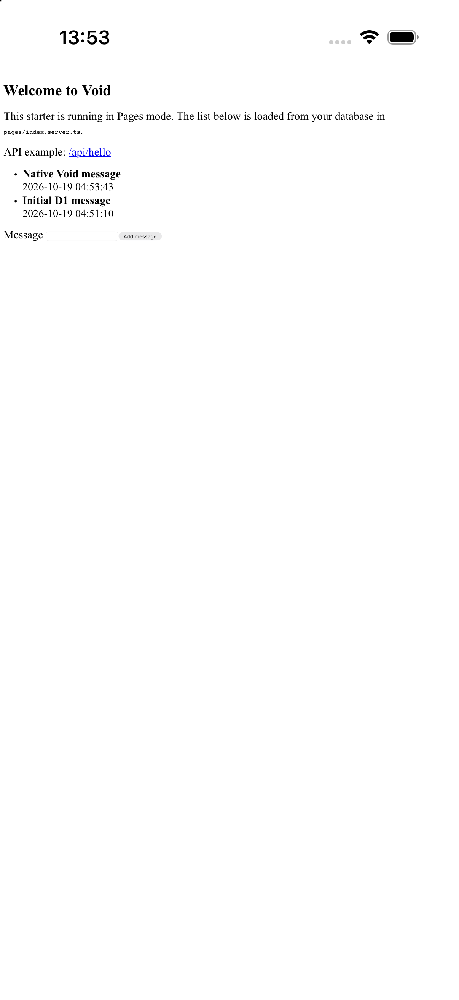

# workers-capacitor

**Bring Cloudflare Workers apps to iOS and Android.**

You built a web app. Now put it on your phone.

workers-capacitor brings your existing Workers application into an iOS or Android app with minimal application changes. Keep the pages you designed, the routes you wrote, and the forms and data that make it yours. Continue serving the web version from Cloudflare Workers, and add a mobile app alongside it.

**Built with Void? Your app can make the same move.** Void React Pages + D1 works with the released Void 1.1.12 packages, including page rendering, interactive forms and navigation.

<p align="center">
  
</p>

_The Void starter running in an iOS simulator after submitting a message to D1. The same flow passes on Android. [Try the sample](demo/void) · [Connect your Void app](docs/void.md)_

## Start with your app

[Capacitor](https://capacitorjs.com/) packages your web interface as an installable mobile app and connects it to native features through plugins. workers-capacitor connects your existing Workers pages and APIs to that app.

| Your application        | Start here                                                                                           |
| ----------------------- | ---------------------------------------------------------------------------------------------------- |
| Void React Pages + D1   | [Connect your generated Void Worker](docs/void.md)                                                   |
| Hono or Workers Express | [Connect your existing Worker](docs/build-setup.md#frameworks) · [Rendering example](demo/rendering) |
| Next.js / OpenNext      | [OpenNext integration](docs/opennext.md)                                                             |

**0.1.0 Preview** — for trying integrations and giving feedback. Start with the [installation and integration guide](docs/integration.md) to add Capacitor, connect your Worker and run your app. It covers both existing Capacitor projects and your first mobile app. iOS development needs Xcode on macOS; Android development needs Android Studio and its SDK.

### Working with an AI coding assistant?

Open your existing application repository and give your assistant this prompt:

```text
Follow https://github.com/rdlabo-dev/workers-capacitor/blob/main/docs/integration.md
to bring this app to iOS and Android with workers-capacitor.
Preserve its pages, routes and authentication; verify it on the target platforms.
```

The same [step-by-step guide](docs/integration.md) works for manual setup.

## What changes in your application?

Add a Capacitor build alongside your existing Cloudflare build, point it at your Worker entry, and initialize workers-capacitor. Your application continues to own its pages and routes.

For example, a Hono Worker exporting `app` can be connected through the Capacitor build's Vite configuration:

```ts
import { defineConfig } from "vite";
import { workersCapacitorPlugin } from "workers-capacitor/tooling/vite";

export default defineConfig({
  plugins: [workersCapacitorPlugin({ worker: "./src/worker.ts" })],
});
```

Then open its first page from the Capacitor entry:

```ts
import { workersCapacitor } from "workers-capacitor";

const app = workersCapacitor({
  baseURL: "https://worker.invalid",
  render: "/",
});
await app.ready;
```

This is the local Worker example; `baseURL` is the logical origin the handler receives. For Void, OpenNext or cloud bindings such as D1, follow the linked framework guide to configure your existing deployed Worker as the remote endpoint. The [complete setup](docs/integration.md) includes installation, the bootstrap page, build scripts and native projects.

Already have a frontend calling Worker APIs? Keep it, omit `render`, and use the [Fetch-only integration](docs/runtime.md#fetch-only-integration).

## Your app, on the device and in the cloud

Supported handlers can run on the device without an HTTP server. Requests that need cloud services run on your existing deployed Worker. D1 stays on Cloudflare; pages and forms can continue using it through that Worker.

Worker-generated HTML becomes the app's page, including its client scripts and navigation. Keep your existing rendering model: adopting workers-capacitor does not require rewriting the application as an SPA. With Capacitor plugins, your app can also access native device features.

The build reports which requests execute locally or remotely. See [execution policies](docs/cloudflare-bindings.md) and [runtime behavior](docs/runtime.md) when you need those details.

## Before you ship

Keep secrets on the server and authenticate requests from the app. Packaged code is readable by users, and rendered pages can access the app's Capacitor plugins. The [integration guide's security checks](docs/integration.md#5-security-the-device-is-not-a-trusted-server) cover these boundaries.

Support depends on your application's APIs and authentication flow. Review the [known limitations](docs/compatibility.md) and test your own app on its target platforms. Preview APIs may change before a stable release.

Tests cover browser, simulator/emulator and selected physical-device scenarios. Void 1.1.12 passes iOS simulator and Android emulator acceptance; physical iPhone checks also cover packaged Hono/Express and public-HTTPS OpenNext, D1, Images and a synthetic OAuth flow. See [verification scope and reproduction](demo/tests/README.md) for the exact boundaries.

## Explore and contribute

- [Examples](demo/README.md): see how applications connect to workers-capacitor.
- [Build setup](docs/build-setup.md): Vite, esbuild and browser ES modules.
- [Native rendering API](docs/native-rendering-api.md): pages, forms, assets and lifecycle.
- [Development and testing](docs/development.md) · [Contributing](CONTRIBUTING.md).

## License

[MIT](LICENSE).
