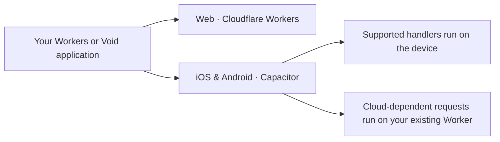

# workers-capacitor

**Your Workers app. On iOS and Android.**

Bring your existing **Cloudflare Workers or Void application** to iOS and Android with Capacitor. Keep your pages, routes, forms and business logic, with minimal application changes. You can keep server-rendered HTML and ordinary page navigation; converting the application to a SPA is optional.

[Capacitor](https://capacitorjs.com/docs) packages a web interface as an installable iOS or Android app. The interface runs in a **WebView**, the operating system's embedded browser, and plugins connect it to native device features. Your UI stays HTML, CSS and JavaScript inside the mobile app.

**workers-capacitor connects your Workers application to that native app.** It adds the handler execution and document integration needed to reuse Worker-generated pages and APIs.

Supported code runs on the device. Requests that need D1, R2 or other cloud services run on your existing Worker.



**Void React Pages + D1:** connect the generated Worker and keep SSR, hydration and form actions. In this integration, page rendering, loaders and actions execute on your deployed Worker; the returned pages and their client JavaScript run in the app's WebView. Use **Void / @void/react v1.1.12 or newer**, which includes Capacitor iOS navigation support. [Void setup and verification](docs/void.md).

**0.1.0 Preview** is for integration and evaluation. APIs and compatibility boundaries may change. Start with the [integration guide](docs/integration.md), or read on to see how your application fits.

## How it works

A Capacitor WebView displays the HTML returned by your Worker. Opening a page, following a link or submitting a supported form reaches the same application routes. The response becomes a WebView document, with its scripts and resources.

The build integration determines where requests execute:

| Request                                                        | Execution                                                          |
| -------------------------------------------------------------- | ------------------------------------------------------------------ |
| A route whose dependencies support local execution             | The handler runs in JavaScript on the device.                      |
| A route that needs D1, Hyperdrive, R2 or another cloud service | The whole request goes to your existing deployed Worker.           |
| An application that cannot be safely separated                 | The whole Worker executes remotely; the build reports this choice. |

**D1 stays on Cloudflare.** The integration forwards requests that need it; your existing Worker still performs the database operations. The build excludes detected server-side implementations, including their SQL, from the device bundle. Authentication and authorization remain on the server.

The local path uses a compatibility layer for supported Workers and Node.js APIs, together with native WebView and networking integration. It runs without starting a local HTTP server. Cloud-dependent features still need a network connection; local execution alone does not make the entire application offline-capable.

See [cloud services and execution policies](docs/cloudflare-bindings.md), including [local or remote KV](docs/remote-service-bindings.md).

## Build setup

Start with your framework, then choose the tool for its Capacitor build.
[Framework setup and execution boundaries](docs/build-setup.md#frameworks) explain
which entry to connect and where the application runs.

### Frameworks

| Framework              | Integration                                                                                                              | Guide                                                  |
| ---------------------- | ------------------------------------------------------------------------------------------------------------------------ | ------------------------------------------------------ |
| **Hono**               | Local pages and APIs; cloud-dependent requests run remotely.                                                             | [Hono](docs/build-setup.md#hono)                       |
| **Workers Express**    | Local pages and APIs using the Workers Express entry; cloud-dependent requests run remotely.                             | [Workers Express](docs/build-setup.md#workers-express) |
| **Void React Pages**   | Remote SSR, loaders and actions with client hydration and forms. Requires v1.1.12 or newer; see the verification record. | [Void](docs/void.md)                                   |
| **Next.js / OpenNext** | Remote D1-backed application; a separate local profile covers public pages.                                              | [OpenNext](docs/opennext.md)                           |

**Angular on Workers** is planned for existing Angular SSR applications deployed
to Workers. Its dedicated setup and acceptance sample are not yet verified;
see the [integration status](docs/build-setup.md#angular-on-workers).

### Tools

| Tool               | Capacitor build setup                                                                                                             |
| ------------------ | --------------------------------------------------------------------------------------------------------------------------------- |
| Vite 7             | [Vite plugin](docs/build-setup.md#vite)                                                                                           |
| esbuild 0.28       | [esbuild plugin](docs/build-setup.md#esbuild)                                                                                     |
| Browser ES Modules | [Explicit source](docs/build-setup.md#browser-es-modules-no-bundler) for browser-compatible JavaScript and Fetch-only integration |

Already have a separately built frontend? Use [Fetch-only integration](#already-have-a-frontend).

## Quick start

Choose [AI-assisted setup](#with-an-ai-coding-assistant) or [manual setup](#manual-setup).

### With an AI coding assistant

Open your existing application repository in your coding assistant and paste:

```text
Follow https://github.com/rdlabo-dev/workers-capacitor/blob/main/docs/integration.md
to bring this app to iOS and Android with workers-capacitor.
Preserve its pages, routes and authentication; verify it on the target platforms.
```

### Manual setup

**New to Capacitor?** Start with the [installation and native project setup](docs/integration.md#2-install-capacitor-and-this-package). It adds iOS/Android projects alongside your existing application and connects the built web assets. You will need Xcode for iOS or Android Studio and its SDK for Android.

The example below connects a Worker that returns HTML to an existing Capacitor 8 application using Vite. For Capacitor installation, the bootstrap HTML and a separate native build directory, follow the [complete setup](docs/integration.md). Void applications should use their [generated entry configuration](docs/void.md#build-and-connect).

#### Install

Install the latest release in your Capacitor application:

```sh
npm install workers-capacitor
```

Native integration uses Swift Package Manager on iOS and Gradle on Android. See the [native setup](docs/development.md#native-demo) for SDK requirements and Android resource rules.

#### Connect your existing Worker

Add the plugin to the **Capacitor build's** Vite configuration. Keep the Cloudflare build unchanged.

```ts
import { defineConfig } from "vite";
import { workersCapacitorPlugin } from "workers-capacitor/tooling/vite";

export default defineConfig({
  plugins: [workersCapacitorPlugin({ worker: "./src/worker.ts" })],
});
```

The path is relative to the Vite root and points to your application's Fetch Handler, such as Hono's `export default app`. For other layouts, set an absolute path. [esbuild and other build setups](docs/build-setup.md) are documented separately.

Initialize the runtime from the Capacitor application's bootstrap:

```ts
import { workersCapacitor } from "workers-capacitor";

const app = workersCapacitor({
  baseURL: "https://worker.invalid",
  render: "/",
});
await app.ready;
```

`render` opens the initial Worker-rendered page. `baseURL` is the logical HTTP(S) origin the handler receives; setting it does not send requests to that server. The visible page keeps the app's local URL.

**Using cloud bindings?** Configure the existing Worker and its binding declarations in the build plugin, then add `remote: { origin: "https://your-worker.example" }` to the runtime options. Follow the [D1](docs/d1-transparent-migration.md), [Hyperdrive](docs/hyperdrive-transparent-migration.md) or [other binding](docs/remote-service-bindings.md) guide, including the build report and your existing authentication. This selects remote execution before the handler runs.

Build the Capacitor web assets, then synchronize and run the native app:

```sh
npm run build
npx cap sync
npx cap run ios # or android
```

See the [Hono/Express rendering demo](demo/rendering) and [native rendering API](docs/native-rendering-api.md) for navigation, forms, assets and lifecycle details.

#### Already have a frontend?

Omit `render` and use an API path boundary. Your existing UI keeps its ordinary Fetch calls:

```ts
const app = workersCapacitor({
  baseURL: "https://api.example.com/api/",
});
await app.ready;

const response = await fetch("/api/hello");
```

Use the same build plugin to connect the API Worker. Matching calls run locally or use the configured remote dispatch; requests outside the boundary retain their normal Fetch behavior. [URL matching and execution details](docs/runtime.md).

## Before you ship

Check the [compatibility and application integration limits](docs/compatibility.md) against your application. These are the main boundaries:

- **Local execution depends on API support.** The compatibility layer covers a defined set of Workers and Node.js behavior. Remote service support does not imply local emulation of those services. WebSockets and local scheduled/queue/workflow lifecycles are unsupported.
- **The device is not a trusted server.** Packaged code and data are readable. Keep secrets on the Worker, authenticate and authorize remote requests, and inspect the build report. Server-code removal is not a general secret scanner.
- **Rendered pages have Capacitor plugin access.** Render trusted application HTML and verify authentication, redirects and plugin behavior in your actual app.
- **Native acceptance has limits.** Tests cover iOS simulators and Android emulators; physical-device acceptance remains outstanding. The Void guide distinguishes the v1.1.12 requirement from the existing patched-client verification record.

The project verifies local workerd contracts, Chromium/WebKit behavior, packed-package consumers and native application scenarios. [Verification scope](demo/tests/README.md) and [CI requirements](CONTRIBUTING.md#ci-and-regression-protection) describe what those checks establish.

## Next steps

- **Integrate your application:** [step-by-step guide and AI prompt](docs/integration.md).
- **Try an example:** [Worker-rendered pages](demo/rendering), [Void](demo/void), or [OpenNext](demo/opennext).
- **Look up behavior:** [build setup](docs/build-setup.md), [runtime semantics](docs/runtime.md), [native rendering](docs/native-rendering-api.md), and [compatibility](docs/compatibility.md).
- **Develop the library:** [development and testing](docs/development.md), [contract API](docs/contracts.md), and [contribution policy](CONTRIBUTING.md).

## License

[MIT](LICENSE).
